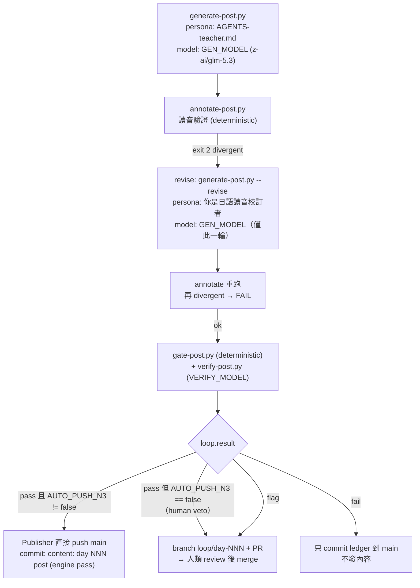

# 引擎流程架構（誰寫、誰校、誰審、誰訂）

daily-loop 引擎的架構說明，回答核心問題：**手動 loop 上，誰寫下第一次的短文？寫完之後，誰做校稿、審批、再訂正？** 操作步驟見 `engine-runbook.md`；設計決策見 `plans/agent-loop-design.md`。本文撰於 2026-11-22，對應當下的 `tools/` 實作。

## Overview

「手動 loop」是 `.github/workflows/daily-loop.yml` 裡的單一 job `loop`：除了 checkout 和裝 dependency，整個 workflow 只做一件事 — 執行 `python tools/daily-loop.py`。所有 arming 判斷、verdict 計算、審批與發布政策都住在 `tools/daily-loop.py` 這個 orchestrator 裡（workflow YAML 只是 env 和 inputs 的通道）。它為「某一天」產出一篇 Hexo post（日文 N3 短文＋中日對照＋單字卡＋文法＋ruby 標音＋TTS 音檔），全程在 temp sandbox 中跑，live 模式才會 commit/push/upload。

流程共有四種 actor：

- **一個 writer model**（初稿＋讀音訂正）
- **一個不同 vendor 的 verifier model**（跨模型校稿）
- **兩個 deterministic 的 Python 檢查器**（annotate 讀音驗證、gate 規則 QA）
- **人類**只出現在三個地方：手動 dispatch、`AUTO_PUSH_N3` veto 開關、PR merge

## Key Concepts

| 名詞 | 是誰 / 在哪 |
|---|---|
| `AGENTS-teacher.md` | **writer 的 persona**：「日文學習內容編輯兼日語老師」，整份檔案被 `generate-post.py` 原文塞進 prompt 開頭。注意 repo root 的 `AGENTS.md`（創業家 mentor）與引擎無關，那是 Claude Code session 用的。 |
| `generate-post.py` | Stage 2，寫初稿；同一支 script 的 `--revise` mode 兼任讀音訂正者。經 OpenRouter 呼叫 `GEN_MODEL`（default `z-ai/glm-5.3`）。 |
| `annotate-post.py` | Stage 3，deterministic 讀音驗證器（fugashi/UniDic＋JMdict/jamdict＋pykakasi），不是 model。exit 2 = divergent、3 = low_confidence。 |
| `gate-post.py` | Stage 4 的規則 QA（結構、長度、ruby coverage、翻譯、gold replay）。verdict PASS/FLAG/FAIL，exit 0/3/2；HARD issue → FAIL、SOFT → FLAG。 |
| `verify-post.py` | Stage 4 的跨模型審校者，prompt 開頭即「你是日語 N3 教材的審校者（不同於產文的模型）」，模型為 `VERIFY_MODEL`（default `openai/gpt-6.1-sol`），第一行必須是 `VERDICT: PASS\|FLAG\|FAIL`。 |
| `daily-loop.py` | Orchestrator：select → generate → annotate → gate → verify → tts → finalize → publish → log 的順序、flag 累積、verdict 計算、`Publisher` 的 git/gh 操作全在這。 |
| `AUTO_PUSH_N3` | GitHub repo variable 的 human veto：`"false"` 時 PASS 也不准直接 push main，改開 PR 給人看。 |
| META line | 每個 stage tool 的最後一行 stdout 是一個 JSON（model、usage、cost_usd、fake…），由 `loop_support.parse_meta_line` 解析，是 stage 之間回傳 cost/URL 的接線。 |

## How It Works

### 1. 觸發：人類手動 dispatch

`workflow_dispatch` 帶兩個 inputs：`day`（回填過去天數，空值＝當天）和 `live`（boolean，是否真的發布）。Workflow 把 `LOOP_EVENT`、`LOOP_DISPATCH_LIVE`、`GEN_MODEL`、`VERIFY_MODEL`、`AUTO_PUSH_N3`、`OPENROUTER_API_KEY`、`LOOP_PAT` 等 env 傳給 `tools/daily-loop.py`。`resolve_arming` 決定 live/dry：dispatch 只有在 `LOOP_DISPATCH_LIVE == "true"` 時才 live（`ENGINE_LIVE` 只管 schedule）。

### 2. 誰寫初稿：`AGENTS-teacher.md` persona ＋ `GEN_MODEL`

`Loop.execute` 的 `generate` stage 呼叫 `generate-post.py --day N --out draft-raw.md --fewshot <前一天 post> --digest digest.json`。`build_prompt` 組出：

- **persona**：整份 `AGENTS-teacher.md`（老師／編輯人格）
- 當天主題 row（`aidd-docs/references/japanese-theme-rotation.md` 的 100 天主題表，不可換題）
- 硬性要求（含長度 band 與低於上限的長度目標）
- 一篇 few-shot gold post（`pick_fewshot` 取前一天的 post）＋近篇 digest（防重複）

模型（`GEN_MODEL`，default `z-ai/glm-5.3`）輸出整個 Markdown 檔。**但模型只擁有 `description` 一個 front-matter 欄位**：orchestrator 的 `split_draft` + `compose_post` 把其餘欄位（title、date、level、generated_by、verified_by…）全部重寫。接著跑一次 draft 專屬的 annotate＋gate，`measured_length` 讀 gate 實測字數後，`sync_length_claim` 把模型自己寫的「約 N 字」宣告（description 與導言 blockquote）**強制改寫成實測值（取十位整）**——模型的自我估計不被信任。

### 3. 誰校稿：三層，兩層 deterministic、一層跨模型

1. **`annotate-post.py`（讀音校稿，純 deterministic）**：用 UniDict tokenization、JMdict attestation、pykakasi 三方證據驗證每個 ruby `<rt>` 讀音。divergent → exit 2。
2. **`gate-post.py`（規則校稿，純 deterministic）**：結構、長度上限/下限、ruby coverage、每段中日對照、單字卡、文法、週日寫作提示、JMdict/EDRDG 授權行、annotation freshness、gold corpus byte-identical replay。HARD issue 整篇 FAIL。
3. **`verify-post.py`（內容品質校稿，跨模型）**：`VERIFY_MODEL`（default `openai/gpt-6.1-sol`）審讀音自然度、N3 適切性、重複度、中譯、結構。select stage 有 preflight：`loop_support.vendors_distinct` 檢查 gen/verify 必須**不同 vendor**，同家則 `verify_allowed = False`、flag `verifier_vendor`——該 run 禁止 auto-PASS，直接變 FLAG 走 PR。verifier 的 FAIL（exit 2）讓整個 run `verifier_fail`；FLAG（exit 3）只累積 flag；回應第一行不是 `VERDICT: ...` 一律視為 transport error（exit 4），`retry_transport` 重試一次。

三層的結果在 orchestrator 匯合：任何 flag（gate soft reason、`verifier_flag`、`low_confidence`、`tts_failed`…）都讓 `loop.result = "flag"`；只有全綠才是 `"pass"`。

### 4. 誰審批：orchestrator 的 `Publisher` ＋（條件上）人類

「審批」不是單一角色，而是 `Publisher.run`（`daily-loop.py`）依 verdict ＋ veto 決定的三條路：

- **PASS 且無 veto**：`Publisher` 在 throwaway worktree（從 fetch 回來的 `origin/main` 開）commit post＋annotation＋ledger，commit author 是 `jasdoit-engine <engine@jasdoit.local>`，用 `LOOP_PAT` push。人類完全不介入。
- **PASS 但 `AUTO_PUSH_N3 == "false"`**：`daily-loop.py` 的 `veto = loop.env.get("AUTO_PUSH_N3") == "false"` 成立 — ledger 先落地 main，內容 push 到 `loop/day-NNN` branch 並 `gh pr create`。**這是人類審批的入口**：runbook §6.1 明說這是「花 3–5 分鐘看完就 merge」。要恢復自動發布就 `gh variable delete AUTO_PUSH_N3`；**未設或不是字面 `"false"` 都不算 veto**。
- **FLAG**：自動走同一條 PR 路（PR 標題 `loop: day NNN FLAG`），一樣是人 merge。
- **FAIL**：只留一筆 `loop: day NNN fail ledger` commit，內容不出去。

### 5. 誰訂正：分兩種，只有一種是自動的

- **讀音訂正（自動、僅一輪）**：annotate exit 2 時，`run_annotate(revise=True)` → `revise_readings` 呼叫 `generate-post.py --revise DRAFT --findings <annotate report> --out post-revised.md`。`build_revision_prompt` 用的**不是** AGENTS-teacher persona，而是「你是日語讀音校訂者」，prompt 帶整份草稿＋每個 finding 的完整證據（unidic/jmdict/tokens/pykakasi），並且**依 finding reason 分支**：一般 finding 只准改該處 `<rt>` 寫平假名；`malformed_ruby` 的行沒有讀音證據，允許重整該行 ruby 標記結構。訂正者模型仍是 `GEN_MODEL`（同一個 writer）。回來後 orchestrator 用 `revision_violation` 做 byte 級監督：把 `<rt>` 內容挖空逐行比對，任何 `<rt>` 以外的改動（且不在 malformed_ruby 行上）→ `revision_violation` FAIL。**只有這一輪**：重跑 annotate 再 divergent 就 `revision_failed` FAIL。API 費用不管採不採用都記在 `revision_cost_usd`。
- **內容級訂正：沒有自動迴圈。** verifier FLAG / gate soft issue 不會把文章退回重寫，只會把發布路徑降級成 PR；FAIL 就是 run 失敗。要重寫內容，是人類重新 dispatch 該天或在 PR 裡改。唯一近似的是 finalize 的一次重入：final gate 出 soft FLAG 時「re-entering finalize once (amendment 9)」重跑 annotate＋gate 一次。

## Where Things Live

| 檔案 | 角色 |
|---|---|
| `.github/workflows/daily-loop.yml` | 手動入口；job `loop`、step `Run daily loop` 只跑 `python tools/daily-loop.py` 傳 env |
| `tools/daily-loop.py` | Orchestrator＋`Publisher`；arming、verdict、veto、degraded latch、PR/push |
| `tools/generate-post.py` | 初稿（`AGENTS-teacher.md` persona）＋ `--revise` 讀音訂正（校訂者 persona） |
| `tools/annotate-post.py` | Deterministic 讀音驗證；report 寫到 `data/annotations/<stem>.json` |
| `tools/gate-post.py` | Deterministic 規則 QA；`length_band`、`GATE_EFFECTIVE_DAY = 18` |
| `tools/verify-post.py` | 跨模型審校（`VERIFY_MODEL`），`VERDICT:` 第一行制 |
| `tools/tts-upload.py` | TTS 產音檔上 R2（`R2_*` env），live 沒拿到 URL 會 flag `tts_failed` |
| `AGENTS-teacher.md` | writer persona（`build_sandbox` 會複製進 sandbox） |
| `aidd-docs/references/japanese-theme-rotation.md` | 100 天主題表（`Day 1 = 2026-11-04` anchor）；row 沒填 → `theme_row_missing` |
| `data/loop-log.jsonl` / `data/engine-state.json` | Run ledger 與 degraded 狀態 |
| `aidd-docs/engine-runbook.md` | 人類操作手冊（§6.1 `AUTO_PUSH_N3`、backfill、補音） |
| `aidd-docs/plans/agent-loop-design.md` | 設計文件（Ruling A：`n3_vocabulary` 由 verifier PASS 閉合；veto 語義） |

## Gotchas

- **`AUTO_PUSH_N3` 的 veto 是字面字串比較**：只有 `"false"` 精確成立才 veto；`"False"`、`"0"`、未設都照樣 auto-push。這是 `daily-loop.py` 裡一行 `loop.env.get("AUTO_PUSH_N3") == "false"`。
- **verifier vendor preflight 是間接審批**：`GEN_MODEL` 和 `VERIFY_MODEL` 設成同一家（例如都是 `z-ai/...`）不會 fail，但該 run 被剝奪 auto-PASS 資格（flag `verifier_vendor`），必然走 PR。
- **訂正只有一輪、而且只管讀音**：revise 模型改掉任何一個 `<rt>` 以外的 byte，整個 run 直接 `revision_violation` FAIL，不重試。惡意/笨拙的訂正不會污染正文。
- **長度宣告是事後校正的**：模型寫「約 280 字」不可信；orchestrator 在 verify 前用 gate 的 reading-locked 實測數（去掉 `<rp>`/tag、ruby 以 `<rt>` 代換後的漢字＋假名計數）覆寫 front-matter description 和導言 blockquote，取到十位。
- **Gate 有追溯豁免**：`GATE_EFFECTIVE_DAY = 18`，day < 18 的文章長度與週日提示檢查是 `not_applicable`，舊文不追溯。
- **FAIL 三連會鎖引擎**：`enters_degraded` 在主題表連續日期上數到 3 個 live fail 就把 `engine-state.json` 的 `degraded` latch 起來，之後 schedule 一律強制 dry，要 2 次手動 dispatch 的 live PASS 才恢復（`recover_passes`）。
- **live run 要求乾淨樹、且永不碰 ambient checkout**：所有 stage 在 `mkdtemp` sandbox 跑；發布用的 commit 在從 `origin/main` 開的 throwaway worktree 裡組（PR branch 刻意 base 在 ledger commit 之前的 `base`，所以 branch 永不帶 ledger，FLAG merge 不會衝突）。
- **`pending_pr` 是終態不是錯**：branch 和 PR 都已存在時，rerun 該天直接 `FailRun("pending_pr")`——要嘛去 merge，要嘛刪 branch，引擎不會覆蓋。

## 一句話總結

**初稿＝`AGENTS-teacher.md` persona 驅動的 `GEN_MODEL`（glm-5.3）寫；校稿＝兩個 deterministic Python 檢查器（annotate＋gate）加一個跨 vendor 的 `VERIFY_MODEL`（gpt-6.1-sol）；審批＝orchestrator 依 verdict＋`AUTO_PUSH_N3` veto 決定 auto-push 或開 PR 給人類 merge；訂正＝只有讀音訂正是自動的（同一個 `GEN_MODEL` 換校訂者 persona，僅一輪），內容級訂正沒有自動迴圈，靠人類 re-dispatch 或在 PR 手改。**
